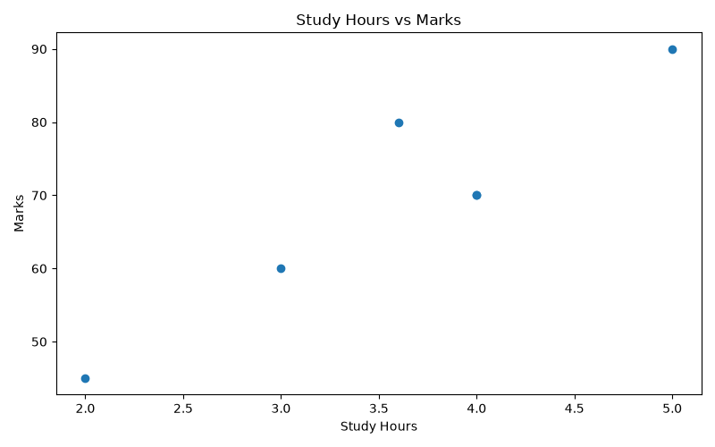
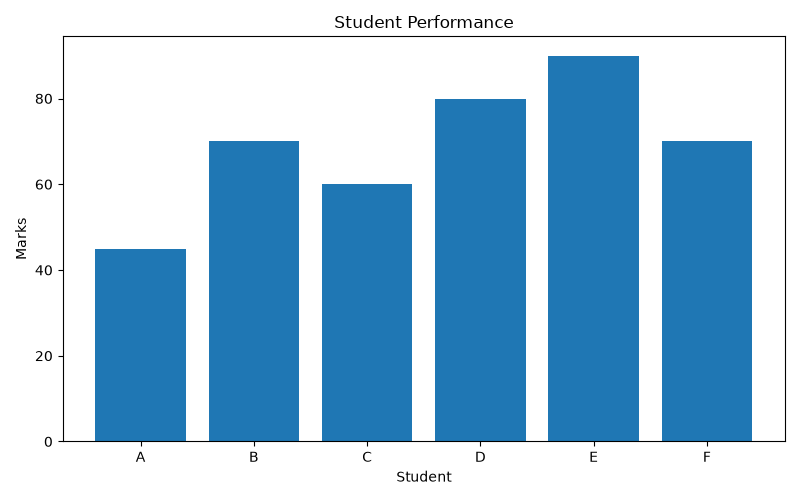

# Lab 3: Data Preprocessing and Exploratory Data Analysis (EDA)

**Student Name:** Hansika Gurjar  
**Roll Number:** IC-2K23-33  
**Course:** Artificial Intelligence  
**Year:** 4th Year  
**Semester:** 7  
**Section:** A  

## Aim

To perform data preprocessing and Exploratory Data Analysis (EDA) using Python libraries such as NumPy, Pandas, and Matplotlib.

## Problem Statement

Analyze a student performance dataset by handling missing values, generating summary statistics, calculating correlations, and visualizing the relationship between study hours and marks.

## Libraries Used

- **NumPy:** Numerical operations and handling missing values.
- **Pandas:** Data manipulation, preprocessing, and analysis.
- **Matplotlib:** Data visualization.

## Dataset Description

The dataset contains information about six students.

| Attribute | Description |
|---|---|
| Student | Student identifier |
| Age | Age of the student |
| Study_Hours | Number of hours spent studying |
| Marks | Marks obtained by the student |

The dataset contains missing values in the `Age` and `Study_Hours` columns.

## Algorithm / Approach

1. Import NumPy, Pandas, and Matplotlib.
2. Create a sample student performance dataset.
3. Display the original dataset.
4. Identify missing values using `isnull().sum()`.
5. Replace missing numerical values with the respective column mean.
6. Remove duplicate records using `drop_duplicates()`.
7. Display the cleaned dataset.
8. Generate summary statistics using `describe()`.
9. Calculate the correlation matrix.
10. Visualize student marks using a bar chart.
11. Visualize the relationship between study hours and marks using a scatter plot.

## Results and Output

### Missing Values

Before preprocessing:

```text
Student        0
Age            1
Study_Hours    1
Marks          0
```

After preprocessing, all columns contain six non-null values.

### Summary Statistics

The dataset contains six student records.

- Average Age: 20.8 years
- Average Marks: 69.17
- Minimum Marks: 45
- Maximum Marks: 90

### Correlation Analysis

The correlation between Study Hours and Marks is approximately:

```text
0.928756
```

This indicates a strong positive relationship between study hours and marks in the sample dataset.

## Visualizations

The program generates the following graphs:

1. **Student Performance Bar Chart:** Displays the marks obtained by each student.





2. **Study Hours vs Marks Scatter Plot:** Shows the relationship between study hours and marks.



## Performance Analysis

Let `n` represent the number of records and `m` represent the number of columns.

- Missing value detection: O(n × m)
- Mean imputation: O(n) for each numerical column
- Duplicate removal: Approximately O(n) average time
- Summary statistics: O(n × m)
- Correlation calculation: O(n × m²) for m numerical columns

The space complexity is approximately O(n × m), considering the dataset and intermediate data structures.

## Learning Outcomes

- Learned to create and manipulate datasets using Pandas.
- Understood how to identify and handle missing values.
- Learned to use NumPy for numerical operations.
- Performed exploratory data analysis using summary statistics.
- Understood correlation between numerical attributes.
- Created bar charts and scatter plots using Matplotlib.
- Learned how data preprocessing improves data quality before analysis.

## Source Code

`DataPreprocessing_EDA.py`
