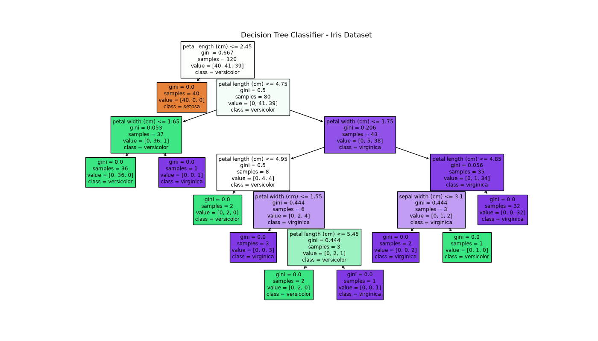

# Lab 5: Decision Tree Classifier and Model Evaluation

## Aim
To implement a Decision Tree Classification algorithm using Python and evaluate its performance on the Iris dataset.

## Problem Statement
Build a machine learning classification model that predicts the species of Iris flowers based on their sepal and petal measurements.

## Dataset
Iris Dataset (available through Scikit-learn).

The dataset contains:
- 150 samples
- 4 features
- 3 target classes: Setosa, Versicolor, and Virginica

## Libraries Used
- Scikit-learn
- Matplotlib

## Algorithm
1. Load the Iris dataset.
2. Separate features and target labels.
3. Split the dataset into training (80%) and testing (20%) sets.
4. Create a Decision Tree Classifier.
5. Train the model using training data.
6. Predict the classes for test data.
7. Evaluate the model using accuracy, confusion matrix, precision, recall, and F1-score.
8. Visualize the decision tree.

## Output
### Model Evaluation Results

**Accuracy: 100%**

### Classification Report

| Class | Precision | Recall | F1-Score | Support |
|---|---:|---:|---:|---:|
| Setosa | 1.00 | 1.00 | 1.00 | 10 |
| Versicolor | 1.00 | 1.00 | 1.00 | 9 |
| Virginica | 1.00 | 1.00 | 1.00 | 11 |
| **Overall Accuracy** | | | **1.00** | **30** |

### Confusion Matrix

```text
[[10  0  0]
 [ 0  9  0]
 [ 0  0 11]]
```

All 30 test samples were classified correctly.

## Visualization
The decision tree visualization is saved as `DecisionTree.png`.



## Result
The Decision Tree Classifier was successfully implemented using the Iris dataset. The model achieved 100% accuracy on the test set, correctly classifying all 30 samples across the three flower species.

The decision tree visualization was also generated successfully.

## Learning Outcomes
- Understood supervised machine learning.
- Learned how decision trees work.
- Practiced training and testing a classification model.
- Learned model evaluation metrics.
- Visualized a trained decision tree.
