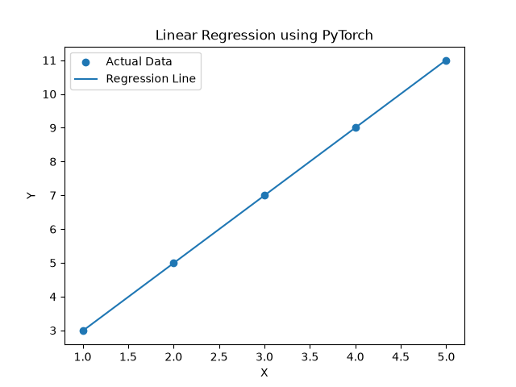

# Lab 6: PyTorch, Linear Regression and Neural Networks

## Aim
To understand and implement Linear Regression and Neural Networks using the PyTorch deep learning framework.

## Experiment 1: Linear Regression

### Problem Statement
Implement a Linear Regression model to learn the relationship between input and output values using PyTorch.

### Algorithm
1. Import PyTorch and required libraries.
2. Create sample input and output data.
3. Define a Linear Regression model.
4. Select Mean Squared Error as the loss function.
5. Use Stochastic Gradient Descent as the optimizer.
6. Train the model for 1000 epochs.
7. Predict the output for X = 6.
8. Visualize actual data and the regression line.

### Results
- Learned Weight: 2.0058
- Learned Bias: 0.9789
- Prediction for X = 6: 13.0140
- Expected Prediction: 13

### Visualization

## Experiment 2: Neural Network

### Problem Statement
Implement a simple Neural Network using PyTorch to solve the XOR classification problem.

### Algorithm
1. Create the XOR dataset.
2. Define a neural network with an input layer, hidden layer and output layer.
3. Use ReLU and Sigmoid activation functions.
4. Use Binary Cross Entropy as the loss function.
5. Train the network using the Adam optimizer.
6. Test the model with all four XOR input combinations.
7. Display predicted and actual outputs.

### Results

| Input | Predicted Output | Actual Output |
|---|---:|---:|
| [0, 0] | 0 | 0 |
| [0, 1] | 1 | 1 |
| [1, 0] | 1 | 1 |
| [1, 1] | 0 | 0 |

Accuracy: 100% (4/4 correct predictions).

## Result
Linear Regression and Neural Network models were successfully implemented using PyTorch. The Linear Regression model learned the relationship between input and output values, while the Neural Network correctly classified all four XOR input combinations.

## Learning Outcomes
- Understood the basics of PyTorch.
- Learned Linear Regression implementation.
- Understood neural network architecture.
- Practiced forward propagation and backpropagation.
- Learned loss functions and optimizers.
- Implemented the XOR classification problem.
