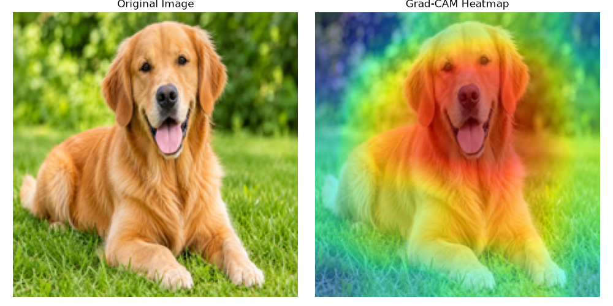
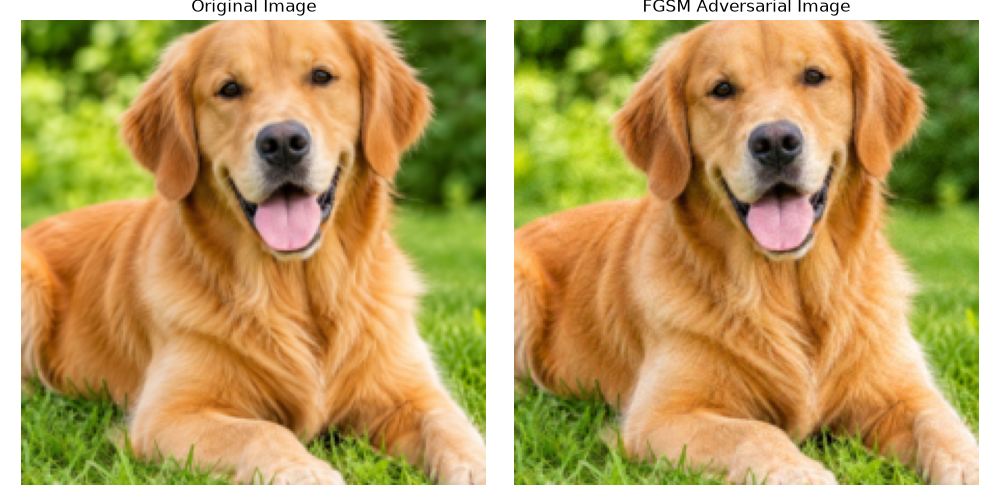
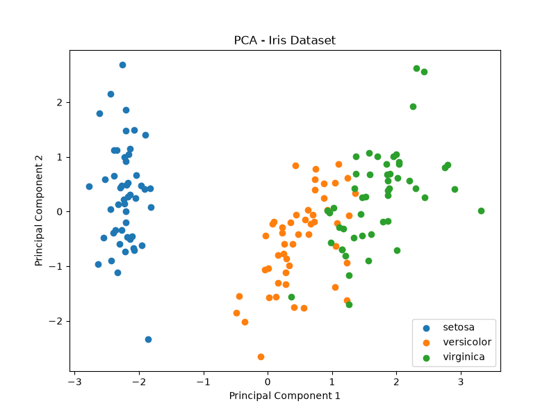
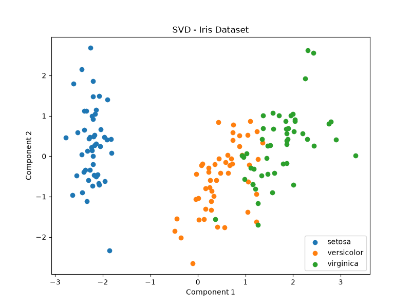
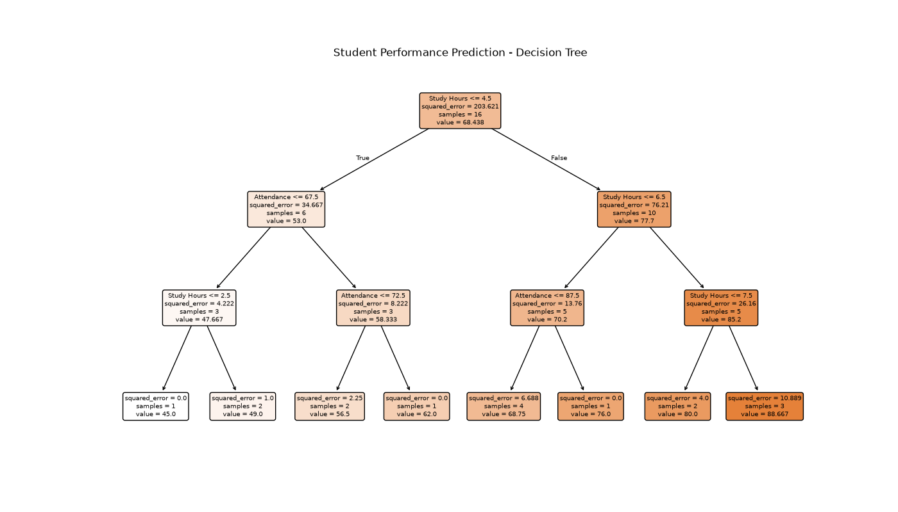

# Lab 7 – Explainable AI, Adversarial Attack, Dimensionality Reduction and Mini-Project

**Name:** Hansika Gurjar  
**Roll Number:** IC-2K23-33  
**Course:** Artificial Intelligence Lab

## 1. Grad-CAM (Gradient-weighted Class Activation Mapping)

### Aim
To visualize important regions of an image that influence a Convolutional Neural Network's prediction.

### Approach
- Used a pretrained ResNet18 model.
- Loaded a Golden Retriever image.
- Applied Grad-CAM using gradients from the final convolutional layer.
- Generated a heatmap highlighting important image regions.

### Output
The Grad-CAM visualization highlights the regions of the image that contributed to the model's prediction.

### Screenshot

### Learning Outcome
Learned how explainable AI helps understand the decisions made by deep learning models.

---

## 2. FGSM (Fast Gradient Sign Method)

### Aim
To understand adversarial attacks and observe how small changes to an input image can affect a model's prediction.

### Approach
- Used pretrained ResNet18.
- Loaded the same Golden Retriever image.
- Calculated gradients using the loss function.
- Applied FGSM with epsilon = 0.05.
- Compared original and adversarial predictions.

### Output
- Original Prediction: Golden Retriever
- Adversarial Prediction: Labrador Retriever

### Screenshot

### Learning Outcome
Learned how adversarial perturbations can influence deep learning model predictions.

---

## 3. PCA and SVD (Dimensionality Reduction)

### Aim
To reduce the dimensionality of a dataset using Principal Component Analysis (PCA) and Singular Value Decomposition (SVD).

### Approach
- Used the Iris dataset.
- Standardized the dataset.
- Applied PCA with 2 components.
- Applied Truncated SVD with 2 components.
- Visualized the reduced datasets.

### Results
- Original Dataset Shape: (150, 4)
- PCA Reduced Shape: (150, 2)
- SVD Reduced Shape: (150, 2)
- Total Variance Retained: Approximately 95.81%

### Screenshots

### Learning Outcome
Understood how dimensionality reduction simplifies datasets while retaining important information.

---

## 4. Mini-Project – Student Performance Prediction

### Aim
To develop a machine learning model that predicts student marks based on study hours and attendance percentage.

### Technologies Used
- Python
- NumPy
- Matplotlib
- Scikit-learn
- Decision Tree Regression

### Approach
- Created a sample student dataset.
- Split the dataset into training and testing sets.
- Trained a Decision Tree Regression model.
- Evaluated the model using MAE and R2 Score.
- Accepted study hours and attendance as user input.
- Predicted marks and categorized student performance.

### Sample Input
- Study Hours: 6
- Attendance: 85%

### Sample Output
- Predicted Marks: 68.75
- Performance: Average

### Screenshot

### Learning Outcome
Learned how supervised machine learning can be used to predict student performance using input features.

---

## Conclusion

In this lab, I explored explainable AI using Grad-CAM, adversarial attacks using FGSM, dimensionality reduction using PCA and SVD, and developed a Student Performance Prediction mini-project using Decision Tree Regression.

These experiments improved my understanding of machine learning, deep learning, model interpretation, and practical AI applications.
